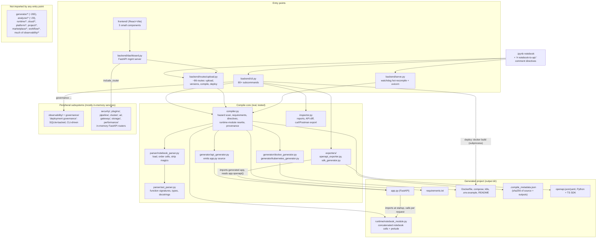

# Architecture: notebook-to-api

Audience: a researcher deciding whether this project could support an arXiv paper.

Scope and method: everything below was derived from reading the repository
(source, tests, CI config) and from running the compiler on the bundled sample
notebook. Nothing comes from the README alone, and nothing is taken from outside
the repo except where it is labelled "outside the repo". Where the code is a
placeholder or a plan, it is marked **[stub]**, **[scaffold]**, or **[planned]**.
Counts are from static analysis on the checked-out tree (commit `181d683`, a
shallow clone, so `git log` does not show the project's true start date).

**Headline for the evaluator:** the project has one real, substantial core (a
notebook-to-FastAPI compiler: parser, compiler, app generator, exporters and
inspector, about 23k lines, plus a 25k-line CLI and a 20k-line upload/management
route module, backed by about 12.7k test cases). Around it sit 682 of the 841
Python modules under `backend/` (81%) that no entry point imports. Many of
those are hardcoded placeholder classes, though not all (see §3.8 and §7). Any
paper claim should rest on the core only.

---

## 1. Problem

**Friction.** A data scientist has logic in a Jupyter notebook: functions,
imports, maybe a trained model. To turn that into a callable HTTP service they
normally hand-write a web wrapper, request/response schemas, a requirements
file, a Dockerfile, auth, docs and client code, and then keep all of it in sync
with the notebook. Notebooks also contain things that break a naive export:
IPython magics (`%time`, `!pip`), `input()`, relative data-file reads, Colab or
Kaggle-only imports, module-level `sys.exit()`, and cells that were run out of
order.

**What the code does about it.** `python -m backend.cli compile nb.ipynb
--output out/` turns every top-level function in the notebook into a
POST endpoint of a generated FastAPI app, and writes the files needed to
run it (runtime module, `requirements.txt`, Dockerfile, compose, Kubernetes
manifest, `.env.example`, README). A large share of the code is *compile-time
analysis of notebook hazards*, so that a notebook that would crash at startup
is reported, rewritten, or handled in the generated app.

**Intended users (inferred from the code, not stated anywhere):** a notebook
author who wants a service without writing web code. Secondary users are a team
that wants a dashboard to upload, version, compile, and deploy many notebooks
(`backend/dashboard.py`, `backend/routes/upload.py`, `frontend/`).

---

## 2. System overview

**Data flow in one sentence.** Notebook JSON → cells (execution order,
magics stripped) → AST extraction of top-level functions → hazard and dependency
analysis → generated `app.py` plus a runtime module (the notebook's own code) →
Docker image or local uvicorn → HTTP request → Pydantic validation → notebook
function call in a worker thread → JSON-safe serialization.

---

## 3. Components

### 3.1 Parser (`backend/parser/`, about 2.1k lines)
- `notebook_parser.py`: loads the notebook with `nbformat` and validates its
  structure. It orders code cells by execution count (`_in_execution_order`).
  It comments out IPython magics, shell escapes and `obj?` introspection, and
  it rewrites `%time x = f()` and `x = !ls` forms. It detects cell magics whose
  body is not Python (`%%bash`, `%%writefile`, ...).
- `ast_parser.py`: uses Python's `ast` to extract top-level (including
  `if`/`try`-nested, excluding `__main__` guard) function definitions. For each
  it records argument names, annotations, defaults (literal or not), `*args`,
  `**kwargs`, keyword-only and positional-only parameters, return annotation and
  docstring (Google/NumPy-style `Args`/`Returns`/`Raises` parsing). It also
  normalizes type strings and builds example payloads. It maps import names to
  PyPI distributions.
- Connects to: called by `compiler.py` and `inspector.py`; no dependencies on
  the rest of the backend.

### 3.2 Compiler (`backend/compiler.py`, about 6k lines, one module)
The orchestration and almost all the project's heuristics live here.
- **Pipeline:** `compile_notebook` → `compile_notebook_to_api` →
  `_compile_notebook_to_api`. It runs under a global `COMPILE_LOCK`. It
  generates the app source *before* writing anything, and on failure it removes
  the files this call created. It refuses to overwrite foreign files, and it warns if a
  previously generated file was hand-edited.
- **Dependency resolution:** classifies imports as stdlib, local module or
  third-party. It maps import names to PyPI names (a static table plus
  `importlib.metadata.packages_distributions()` from the *compiling*
  environment), and it pins versions to what is installed at compile time.
  It also parses `!pip install` / `%pip install` cells and explicit directives.
- **Hazard scan** (`_find_import_time_hazards`; kinds seen in the source:
  `input`, `file_read`, `dir_read`, `request_read`, `request_input`,
  `shell_command`, `undefined_name`, `magic_variable`, `infinite_loop`,
  `gpu_call`, `exit_call`, `debugger_call`, `colab_import`, `blocking_call`).
  These are *reported* by `inspect`/`validate` and in the generated README. A
  few are acted on: relative data files are copied into the output
  (`find_data_files`) and reads inside functions are rewritten to resolve at
  request time.
- **Runtime-module construction:** concatenates cells into
  `runtime/notebook_module.py` with a "Jupyter prelude" (shims for `display`,
  `get_ipython`, `input`, Colab `userdata`, Kaggle secrets, `tqdm.notebook`,
  IPython `_` output references, top-level `await`, `__future__` hoisting).
- **Directives:** comment annotations `# notebook-to-api: requires | exclude |
  private | background | sync | tag | deprecated | timeout | rate-limit | cache
  | apt-requires` that override the compiler's own guesses.
- **Hub/model prefetch:** detects Hugging Face, timm, Keras, torch, spaCy,
  NLTK, sklearn dataset, Whisper and open_clip model usage and emits Dockerfile
  steps to pre-download weights at build time.
- **Provenance:** `.compile_metadata.json` stores the source notebook's SHA-256
  and a SHA-256 of generated files. The generated app exposes the source hash in
  `GET /info`.

### 3.3 App generator (`backend/generator/api_generator.py`, about 7k lines)
Emits a single `app.py` as a Python source string. Per notebook function it
generates a Pydantic request model and a `POST /<function>` route. The
generated app includes:
- `X-API-Key` auth (default dev key, optional hard-fail if a custom key is not
  set), per-key and per-endpoint rate limiting, CORS, gzip, security headers,
  request-ID and request-size middleware, JSON access logs, `/metrics` plus a
  Prometheus form, `/health`, `/ready`, `/info`, `/config`, `/auth/*`.
- Per-request timeouts, a bounded worker-thread pool, an optional response
  cache with TTL, and `Deprecation`/`Sunset` headers (with 410 tombstones for
  functions removed after their sunset date).
- Background endpoints: functions whose name contains `train`, `process`,
  `generate`, `embed` or `scrape` (or marked `# notebook-to-api: background`)
  return a `task_id`; a task store with TTL, optional HMAC-signed webhook
  callbacks, and retries.
- A large `_json_safe` serializer (DataFrames, NumPy/array-likes, bytes, enums,
  dataclasses, `__slots__` classes, iterables, open files, timezone objects,
  ...) and a custom OpenAPI builder with examples and error schemas.
- Rejects notebook function names that collide with the generated app's own
  identifiers (`RESERVED_INFRASTRUCTURE_NAMES`).
- Related, smaller: `docker_generator.py` (Dockerfile on `python:<ver>-slim`,
  non-root user, HEALTHCHECK, compose, `.env.example`, README),
  `kubernetes_generator.py`.

### 3.4 Exporters and inspector
- `exporters/openapi_exporter.py`: imports the *generated* app and writes
  `app.openapi()` as JSON/YAML.
- `exporters/sdk_generator.py` (about 3.3k lines): from that OpenAPI file,
  generates a Python client and a TypeScript client (typed request/response,
  background-task submit/poll helpers).
- `inspector.py` (about 2.7k lines): `inspect`/`validate` reports; API diff
  between two notebooks with a breaking/non-breaking classification
  (`diff_notebook_functions`, `classify_notebook_diff`); `curl` and Postman
  export.

### 3.5 Entry points and management plane
- `cli.py` (about 25k lines, 80 top-level subcommands plus a `governance` command tree): local commands (`compile`,
  `inspect`, `validate`, `export-*`, `serve`, `watch`, `deploy`, `diff`, `doctor`)
  and thin HTTP clients for a running dashboard (`upload`, `list`,
  `remote-*`, `deploy-history`, ...), plus `app-*` commands that talk to a
  running generated app.
- `serve.py`: `watchdog` file watcher; recompiles and restarts a uvicorn
  subprocess on save; also watches local modules, `.env` and shipped data files.
- Dashboard security: `NOTEBOOK_API_DASHBOARD_HOST` defaults to `127.0.0.1`; a
  non-loopback host without `NOTEBOOK_API_DASHBOARD_KEY` is refused at startup
  (`validate_dashboard_exposure`), and a set key is required as `X-API-Key`.
- `dashboard.py` + `routes/upload.py` (about 20k lines): FastAPI management
  server. Stores uploaded notebooks (with versions, tags, descriptions,
  duplicate detection, search, zip import, URL import), compiles them, builds
  Docker images, and keeps compile/deploy history. The `frontend/` (React 19,
  Vite, Tailwind; five components, about 950 lines) is a thin UI over it.
- **Management server wiring:** `dashboard.py` mounts the routers of
  `security`, `plugins`, `pipeline`, `cluster`, `ai`, `gateway`, `storage`,
  `performance`. `app.py` mounts a second `security` stack under `/v2`.

### 3.6 Peripheral subsystems (wired into the dashboard, unrelated to compilation)
`security` (auth, JWT, RBAC, API keys, audit, secrets vault), `plugins` (incl.
a thread-based sandbox whose own docstring says it is not a security boundary
and does not enforce memory limits), `pipeline` (ETL-style registry/scheduler),
`cluster` (worker registry, scheduler, dispatcher), `ai` (model
registry/loader/inference/routing), `gateway` (rate limiter, router),
`storage` (object storage with local/S3/Azure/GCS as *enum labels*),
`performance`. By construction these are in-memory registries behind FastAPI
routers (dicts guarded by `threading.Lock`); no database imports and no
cloud/ML SDK imports were found in them. The `storage` backends other than
"local" are labels, not clients. They do not interact with the compile path.
They are tested (see §8), but nothing connects them to the notebook-to-API
idea.

### 3.7 "Deployment governance" (`backend/observability/`, `backend/governance/`)
About 252 files and 93k lines (`observability`), 10k lines (`governance`).
CLI-driven (`governance doctor`, `governance audits ...`) subsystem with a
SQLite persistence layer: audit history, replay/diff, saved queries, report
templates, notification channels, delivery scheduler/runtime, trace
repository, metrics history, and rollout policies (canary, blue/green,
rolling). It is the largest code body in the repo and is **not part of the
notebook-to-API compilation**; the README documents only `governance doctor`.
It is reached through the CLI's `governance` command tree (the CLI imports 52
of its modules) and two modules from the dashboard. I did not find the compile
path importing it, and I did not trace whether any real deployment flow feeds
it data beyond its own tests.

### 3.8 Unwired scaffolding (**[stub]/[scaffold]**)
Static import analysis from `compiler`, `cli`, `dashboard`, `serve`, `app` and
`inspector` reaches only 159 of 841 backend modules. The unreached ones are:

| Package | Observation |
|---|---|
| `generator/*` (≈265 of 268 files) | 214 of 268 files are under 80 lines with no control flow: dataclasses plus a method returning constants. Examples: `llm_integration.py` returns a fixed `provider="OpenAI"`, `recommended_model="gpt-5.5"`; `autonomous_ai.py` returns four `True` flags; `sdk_release_generator.py` returns `version="1.0.0"`. No LLM or network call exists anywhere in the repo. |
| `analyzer/*` (29 files) | e.g. `static_single_assignment_engine.py` always returns one hardcoded variable `prediction_1`; `call_graph_engine.py` always returns a fixed `predict → preprocess/model_inference` graph. Names suggest SSA, CFG, data-flow, type-inference; the implementations are fixtures. `notebook_intent_analyzer.py` and `cell_classifier.py` are keyword matchers. |
| `runtime/*`, `cloud/*`, `platform/*`, `project/*`, `marketplace/*`, `workflow/*` | Mostly 30-50 line classes returning fixed values (e.g. `RuntimeOrchestrator.orchestrate` always reports `scheduled=True`). Zero tests by module name. |
| parts of `observability/*` (about 199 modules not reached from entry points) | Separate from the stub count above; many have tests, and I have not classified how many are real. |

`generator/pipeline_schema_generator.py` (about 10k lines) imports these stub
analyzers/runtime classes; it and the `pipeline_*` generators are not called by
`compile`. The code suggests an intended direction (multi-stage "pipeline"
endpoints, compiler-style IR analysis) that is **[planned], not implemented**.

---

## 4. Tech stack

| Layer | Choice (from code) |
|---|---|
| Language | Python 3.11 and 3.13 (CI matrix); generated Docker image uses the compiling interpreter's version (`FROM python:<ver>-slim`). JavaScript (React 19, Vite 8, Tailwind 3) for the UI. |
| Notebook I/O | `nbformat`; standard-library `ast`, `tokenize`; regex for magic stripping. |
| Generated service | FastAPI + Pydantic + uvicorn; Starlette middleware. |
| Management server | FastAPI, `httpx` (URL import), `python-multipart`; `watchdog` for hot reload. |
| Persistence | Notebook files and JSON metadata on disk (`uploads/`, `generated/`, `.compile_metadata.json`); SQLite for deployment-governance data. Everything else in-memory. |
| Deployment | Dockerfile, docker-compose, Kubernetes manifest generation; `deploy` shells out to `docker build`. Dashboard and generated apps are single-process. |
| ML models / APIs | None are called by the tool. Model usage in a *user's* notebook is detected only to prefetch weights and map dependencies. No LLM is used anywhere (the "LLM integration" module is a constant). |
| CI | GitHub Actions: `pytest` on Python 3.11 and 3.13, plus a `docker-smoke` job that builds the compiled sample image and checks its container's `/health`. No lint, type-check or coverage steps. |
| Dependencies | `requirements.txt` is unpinned: fastapi, uvicorn, nbformat, watchdog, httpx, python-multipart. Test tooling (`pytest`, `PyYAML`) lives in `requirements-dev.txt`, which includes it via `-r requirements.txt`. |

---

## 5. Key design decisions and trade-offs

1. **Function-level compilation of the notebook's own code, not a kernel.** The
   notebook's cells are concatenated into one module that is imported once at
   startup; endpoints call its functions. *Why:* simple, no Jupyter dependency
   at serve time, FastAPI-native schemas. *Trade-offs:* all top-level cells
   (training, data loading, prints) run at import time on every start; global
   state is shared across requests and threads; only top-level functions are
   exposed, so notebooks that work through top-level statements or class
   methods get no endpoints.
2. **Static analysis only; no execution at compile time.** Hazards are found
   through the AST, not by running the notebook. *Trade-off:* cheap and safe to
   compile, but heuristic: dynamic imports, `exec`, runtime-built paths and
   attribute-heavy code are missed. Dependency versions come from whatever is
   *installed on the compiling machine*, so the output is correct only if that
   environment matches the notebook's.
3. **Report-first, rewrite-sparingly.** Most hazards are warnings rather than
   automatic fixes; a few classes (magics, IPython `_`, Colab/Kaggle shims,
   request-time file reads) are rewritten or shimmed.
4. **Explicit directives beat inference.** Because name-based inference is
   fragile (the code comments give examples: `regenerate_token` is wrongly
   "background" by substring), authors can override with comment directives.
   The background heuristic is a name substring match, which is a weak spot.
5. **Generate source text, don't use a runtime wrapper library.** The output
   is plain, inspectable Python that can be copied and edited. *Trade-off:*
   `api_generator.py` is a 7k-line string-templating module, and every
   generated app carries about 2.3k lines of infrastructure.
6. **Fail before writing; transactional compile.** Output is generated in
   memory first, and partial output is cleaned up on error. A global lock
   serializes compiles because dashboard routes can run in worker threads.
7. **Security defaults:** every endpoint requires `X-API-Key`; the default key
   is public and the app warns about it (optional hard-fail). Notebook code
   executes **unsandboxed** inside the service process. The compiler does not
   address untrusted notebooks; the dashboard has some SSRF-oriented checks for
   URL import (it imports `ipaddress`, `socket`), which I did not audit.
8. **Breadth over depth in the repo.** The commit history (last 20 commits
   visible) is a sequence of narrow notebook-edge-case fixes ("generate X
   instead of failing with Y"), alongside large numbers of generated
   subsystem modules. The first reflects an empirical, bug-driven approach;
   the second is not connected to the core.

---

## 6. What's novel (conservatively)

The code does not contain any new algorithm, model, or learned component.
Novelty, if any, is in *engineering scope and combination*:

- **Compile-time notebook-hazard taxonomy.** A concrete, implemented catalogue
  of why notebook code fails when run as a service (the hazard kinds in §3.2),
  detected statically and tied to remedies. It is the most paper-worthy asset
  and also the least measured.
- **End-to-end artifact generation from one source**: service, schemas,
  Dockerfile (with model-weight prefetch), compose, k8s, SDKs (Python and
  TypeScript), curl/Postman, README, and a content-hash provenance chain from
  notebook to running container (`SOURCE_NOTEBOOK_SHA256` in `GET /info`).
- **API-surface diffing between notebook versions** with breaking-change
  classification, and a deprecation/sunset lifecycle expressed as notebook
  comments.
- Directive-based author control over compile decisions.

What this is **not**: it is not the first notebook-to-HTTP tool. Outside the
repo (from general background, unverified here), the closest related work a
literature check must cover includes Jupyter Kernel Gateway's notebook-http
mode, Voilà, Papermill/Ploomber/nbdev-style notebook-to-pipeline tools, and
model-serving frameworks such as BentoML, MLflow Models and Ray Serve. The repo
contains no comparison against any of them, so a novelty claim cannot be made
from this repository alone.

---

## 7. Current status

**Works end-to-end (verified by me):** compiling `notebooks/sample.ipynb`
produced `app.py`, `runtime/notebook_module.py`, `requirements.txt`, Dockerfile,
compose, k8s, `.env.example`, README and `.compile_metadata.json`. Loading the
generated app in FastAPI's `TestClient` returned correct results for `/add` and
`/predict` with the API key, 422 for a wrongly typed body and 401 without a
key. (The sample notebook has three trivial functions; this is a smoke test,
not evidence of generality.)

**Implemented and covered by tests, not independently exercised by me:**
CLI compile/inspect/validate/diff/serve/watch; OpenAPI and SDK export;
dashboard upload/versioning/compile routes; deployment-governance CLI and
SQLite stores.

**Partial / weak:**
- `deploy` runs `docker build`, but the tests use a fake `docker` executable
  (`tests/test_cli_deploy.py`); I found no test that builds a real image.
- The top-level `README.md`'s "Next Steps" lists "Add more advanced type
  handling", i.e. the authors regard type handling as incomplete.
- Background endpoint selection is a name heuristic (§5.4).
- Management server state outside `uploads/`, `generated/` and the governance
  SQLite DB is in memory and lost on restart; no multi-user isolation of
  notebooks was found.
- Frontend is a thin five-component UI with no tests in the repo.

**Not implemented / [planned] / [stub]:** everything in §3.8; any LLM-based
analysis; real cloud/cluster execution (the `cluster`, `cloud` and storage
"S3/Azure/GCS" modules do not talk to any external system); sandboxing of
notebook code; multi-notebook composition ("pipeline" endpoints).

**Other limitations:** the dependency graph depends on the compiling host's
installed packages; GPU-requiring notebooks are flagged but not given a CUDA
image; no authentication on the *dashboard* was verified by me beyond its own
security routers; repo hygiene issues (committed `uploads/`, `test_generated/`,
an unpinned `requirements.txt`) show it has not been prepared for external use.

---

## 8. Evaluation

**What exists**
- **12,677 test cases collected** by `pytest` (about 12.7k), across 382 test
  files under `tests/`. Distribution by area: governance about 4.0k, upload routes
  1.5k, CLI 1.3k, compiler 644, generator 373, SDK 248, inspector 204, AST 115,
  serve 98, parser 65; the rest are the in-memory subsystems (security 512,
  plugins 299, gateway 277, cluster 266, ai 258, pipeline 257, storage 225,
  performance 210).
- Core tests are behavioural: `test_generator.py` and `test_compiler.py` load
  generated apps (`TestClient`/`importlib`/`exec` appears in 313 and 358 lines
  respectively) rather than only string-matching.
- CI runs the full suite on Python 3.11 and 3.13 for pushes and PRs to `main`.
- **Test results I observed.** The core-pipeline files (`test_ast`,
  `test_parser`, `test_compiler`, `test_generator`, `test_inspector`) ran as
  1,399 passed, 2 skipped, 0 failed in 216 s on Python 3.13. A full-suite run
  (`pytest -x`, which stops at the first failure) was still in progress at
  about 59% when this document was finalized, with no failure reported up to
  that point. I did not obtain a completed full-suite result, so do not read
  "all 12.7k pass" from this document. Tests are slow (minutes), which matters
  for CI.

**What is missing for a paper**
- **No corpus or benchmark.** One sample notebook ships in the repo. Test
  notebooks are small synthetic snippets written to hit a specific branch. There
  is no collection of real-world notebooks (e.g. from Kaggle or GitHub) and no
  measurement of *compile success rate*, *startup success rate*, or *correct
  endpoint behaviour* on them.
- **No ground truth for hazard detection:** no precision/recall of the hazard
  scan, no false-positive/false-negative study, no ablation of the heuristics.
- **No baselines:** no comparison against the related tools named in §6 on
  features, effort, or success rate.
- **No runtime measurements** of generated apps (latency, throughput,
  memory, cold-start, effect of the thread pool/cache/rate limits). The
  `ai/model_benchmark.py`, `ai_benchmarking_engine.py` and
  `performance/*` modules are in-memory services, not benchmarks of this
  system.
- **No user study** or measurement of developer effort saved.
- **No real Docker/Kubernetes integration tests**; CI never builds an image.
- **No security evaluation** of running untrusted notebook code or of the
  dashboard's upload/URL-import paths.
- **No coverage report, linting or type-checking** in CI; the test suite is
  large but dominated by tests of peripheral subsystems and by edge-case
  regressions for the core.
- Reproducibility: unpinned top-level dependencies; the compile output depends
  on the host's installed packages.

**Suggested minimum for a paper** (my recommendation, not in the repo): assemble
a few hundred real notebooks, define "compiles, starts, and answers a correct
request" as the success metric, report failure causes by hazard category,
compare against one or two baselines, and restrict the contribution to the
compile core and hazard taxonomy.
